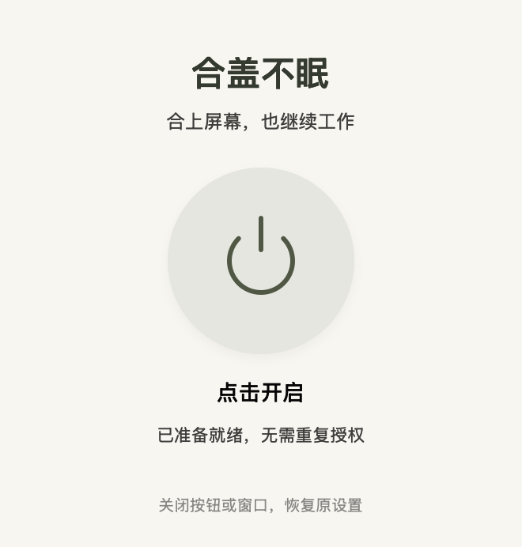

# Lid Awake · 合盖不眠

一个按钮，让合上屏幕后的 Mac 继续工作。

原生 Swift / AppKit 小应用。首次安装授权一次，日常开启、关闭和再次打开无需重复输入管理员密码。关闭开关或退出应用时恢复原来的休眠设置。

[English](README.en.md) · [下载预览版](https://github.com/MoFanMon/lid-awake/releases) · [构建与打包](#从源码构建) · [实现说明](docs/ARCHITECTURE.md)



*界面预览：辅助服务安装完成后的关闭状态。*

## 当前状态

这是 **2.0 开源预览版**。已有自动化逻辑与本机构建校验，但尚未完成不同机器上的管理员安装、系统重启、Intel 硬件和物理合盖测试，欢迎反馈测试结果。

下载产物使用本地临时签名，**没有 Apple Developer ID 签名和公证**。macOS 可能阻止打开；请只运行你信任、核实来源的构建。也可以自行审阅源码后编译。[Apple 关于打开未公证应用的说明](https://support.apple.com/zh-cn/102445)

## 功能

- 一个按钮开启或关闭合盖防休眠。
- 首次安装系统辅助服务时授权，日常使用不保存或重复索要管理员密码。
- 关闭窗口、Command-Q 或应用崩溃后，辅助服务恢复原设置。
- 服务重新启动时，优先恢复磁盘上记录的未结束会话。
- Apple 芯片和 Intel 通用构建，macOS 13 及更新版本。
- 没有第三方运行时依赖。

合盖后 **内置屏幕仍会关闭**；本项目保持电脑继续运行。开启期间也会阻止菜单和闲置触发的系统睡眠。请保持通风、留意电量。

## 安装与使用

1. 从 [Releases](https://github.com/MoFanMon/lid-awake/releases) 下载 `.pkg` 安装包。升级前先退出旧版。
2. 按 macOS 安装器提示完成一次管理员授权，应用和辅助服务会安装到标准目录。
3. 从「应用程序」打开「合盖不眠」，点击电源按钮开启。
4. 再次点击、关闭窗口或退出，恢复开启前的休眠设置。

也可以从 `.dmg` 把应用拖到 Applications。第一次打开会请求管理员授权并安装同一个辅助服务。更换版本、重装、卸载或系统撤销后台服务权限时，可能需要重新授权。

## 从源码构建

需要 macOS 13+ 和 Apple Command Line Tools / Xcode。编译时不需要管理员权限，脚本不会自动安装服务或修改电源设置。

```sh
git clone https://github.com/MoFanMon/lid-awake.git
cd lid-awake
./test.sh
./build.sh
```

应用位于 `dist/合盖不眠.app`。生成 `.pkg`、`.dmg` 和应用 `.zip`：

```sh
./package.sh
```

也可给脚本传入一个绝对输出目录，例如 `./package.sh "$PWD/dist"`。

CI 只运行测试和构建，不安装服务、不调用需要 root 的电源写入。CI 跳过依赖本机电源偏好的只读对照检查；本地默认保留该检查。

## 辅助服务如何工作

普通用户运行 GUI，root 辅助服务由 `launchd` 管理。应用通过本地 Unix socket 发送固定的三种请求：开启、关闭、读取状态。

服务使用 socket 的内核审计令牌识别进程，并校验安装时记录的应用代码签名散列及当前控制台用户。它不接受任意命令或任意电源设置。修改前先将原设置写入私有恢复记录并同步到磁盘；退出或恢复后清理记录。

只修改系统的 `SleepDisabled` 值，其他电源计时不变。如果其他工具原本已禁用系统休眠，关闭本应用时也会保留那个原设置。

安装位置、恢复机制和验证范围详见 [实现说明](docs/ARCHITECTURE.md)。

## 卸载和手动恢复

先关闭开关，从应用菜单选择「卸载系统辅助服务」，然后将应用移至废纸篓。卸载系统服务需要管理员授权。

如需手动恢复允许系统休眠，可在终端运行：

```sh
sudo pmset -a disablesleep 0
```

该命令会恢复允许休眠，不会保留其他工具原本设置的禁止休眠状态。

## 参与项目

欢迎提交 Issue 或 Pull Request。请先阅读 [贡献指南](CONTRIBUTING.md)。涉及权限、签名验证或任意命令执行的问题，请按 [安全报告说明](SECURITY.md) 私下报告。

## 许可证

[MIT](LICENSE) · Copyright © 2026 MoFanMon
